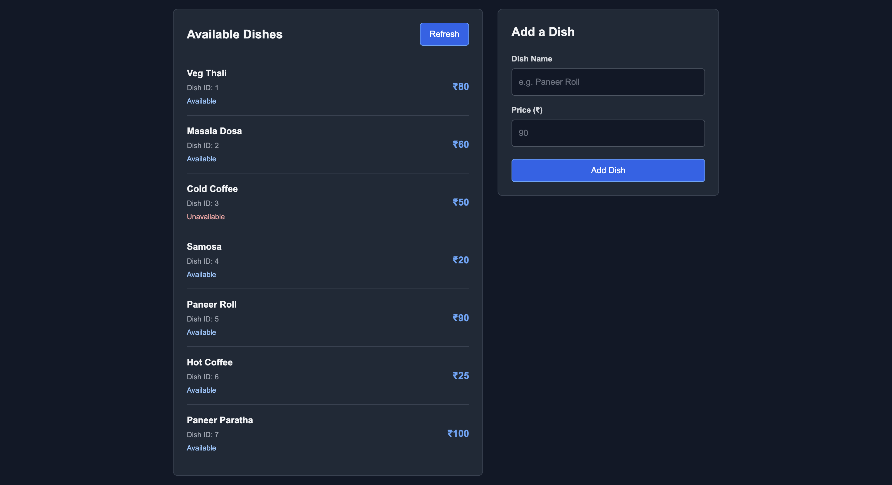
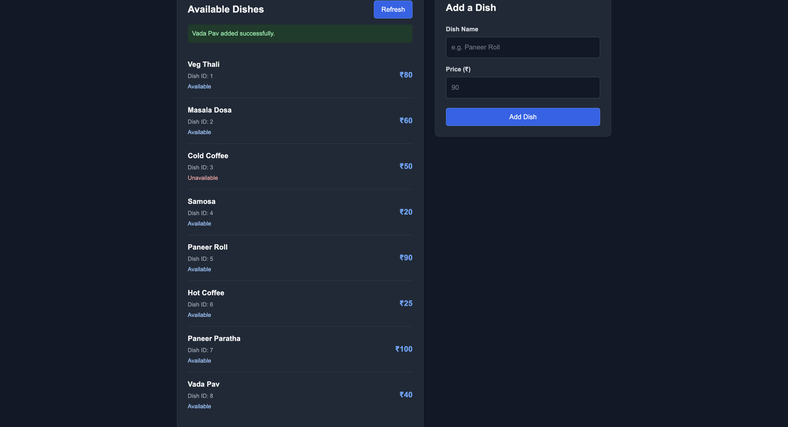

# CampusEats Menu - GraphQL (Assignment 7)

## Group Member

| Name | Student Id |
|---|:---:|
| Ankur Gupta | 20252651008 |
| Kartik Karnwal | 20252651028 |
| Kirti Gautam | 20252651029 |
| Pintu | 20252651038 |

**GitHub repo:** https://github.com/Ankurguptadev/CampusEats
**Google Drive:** https://drive.google.com/drive/folders/1v7WH8PwRlYjhg_WE_O-rvMhAaVHqMqo0?usp=sharing

## How to run it

One line: load `schema.sql` into MySQL, run `npm install`, run `node server.js`, then open `public/index.html` in the browser.

```
mysql -u root -p < schema.sql
npm install
npm start
```

Then open run the `public\index.html` and use the go live option and it will open this `http://localhost:3000/` webpage in a browser.

## Before and after the mutation

| Before  | After clicking "Add dish" |
|---|---|
|  |  |

## What is in the repo

| File | What it is |
|---|---|
| `schema.graphql` | the `Dish` type, the queries and the mutation |
| `server.js` | Apollo Server and the resolvers |
| `db.js` | the MySQL connection pool |
| `schema.sql` | creates the `dishes` table and 4 seed rows |
| `public/index.html`, `public/style.css`, `public/script.js` | the page: lists dishes, one button adds a dish |


The two operations from the assignment:

```graphql
query    { dishes { id name price available } }
mutation { addDish(input: { name: "Paneer Roll", price: 90 }) { id name price } }
```

## Answers

**1. Which CampusEats service did you pick?**
The **Menu** (the Catalogue service). The entity is `Dish` with `id`, `name`, `price` and `available`.

**2. One field a client can skip, and one it cannot (why the `!`)**
- Can skip: **`available`** when adding a dish. It has no `!` (`available: Boolean`), so the server just uses `true`. This works: `addDish(input: { name: "Paneer Roll", price: 90 })`.
- Cannot skip: **`name`** (`String!`) and **`price`** (`Int!`). If a client leaves out `name`, GraphQL rejects the request before any of our code runs: `Field "AddDishInput.name" of required type "String!" was not provided` (see `api-check.txt`, test 7). That is why we use `!`: a dish can never be saved without a name or price. On the output side `!` is a promise: `name` is never null, so the page doesn't need to check for it.

**3. Map it to SQL: which part became the WHERE, and which resolver ran the INSERT?**
- `dish(id: 2)` becomes `SELECT ... FROM dishes WHERE id = 2` (resolver `Query.dish`).
- `dishes(available: true)` becomes `... WHERE available = 1`. If the client leaves `available` out, there is no WHERE at all and every dish comes back (resolver `Query.dishes`).
- The **`Mutation.addDish`** resolver ran the `INSERT INTO dishes (name, price, available) VALUES (?, ?, ?)`. It then reads the new row back with `WHERE id = insertId` so it can return it.
